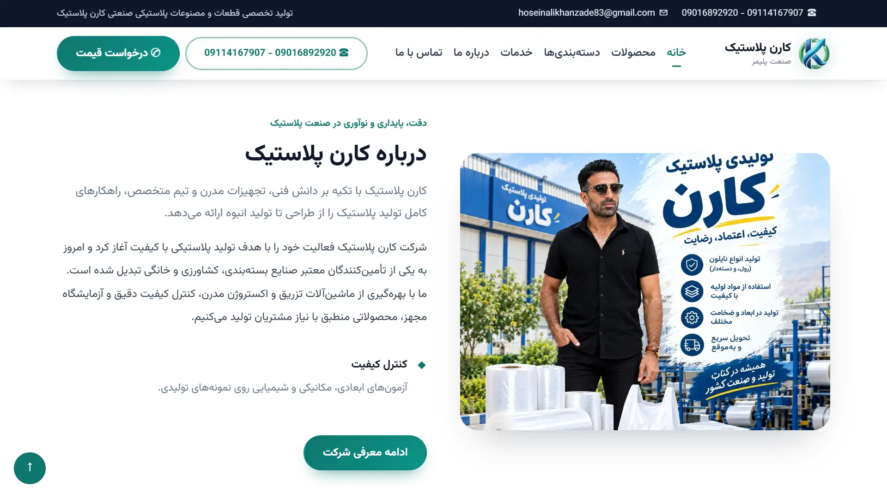
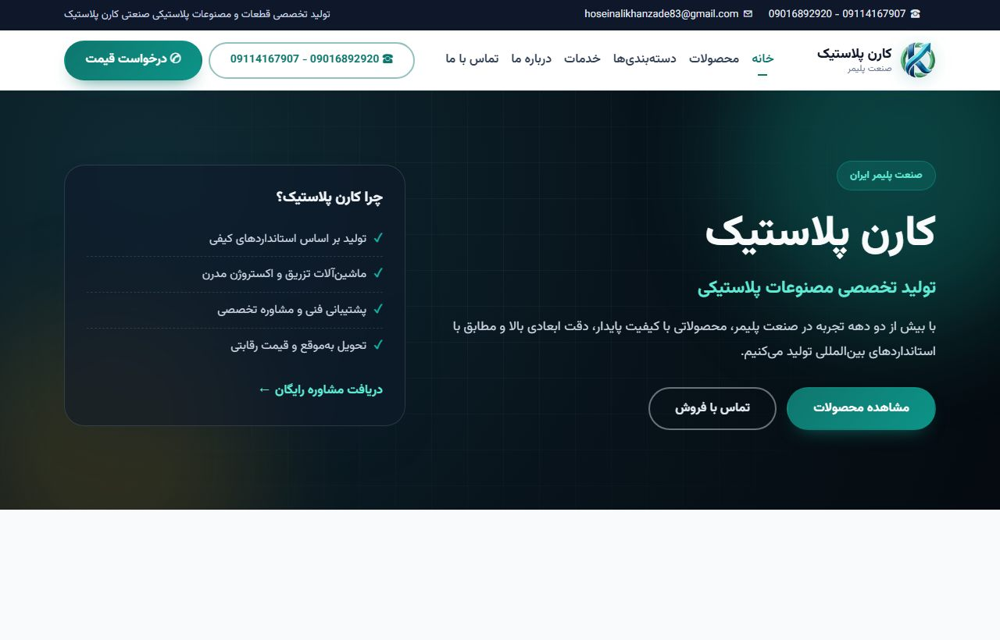
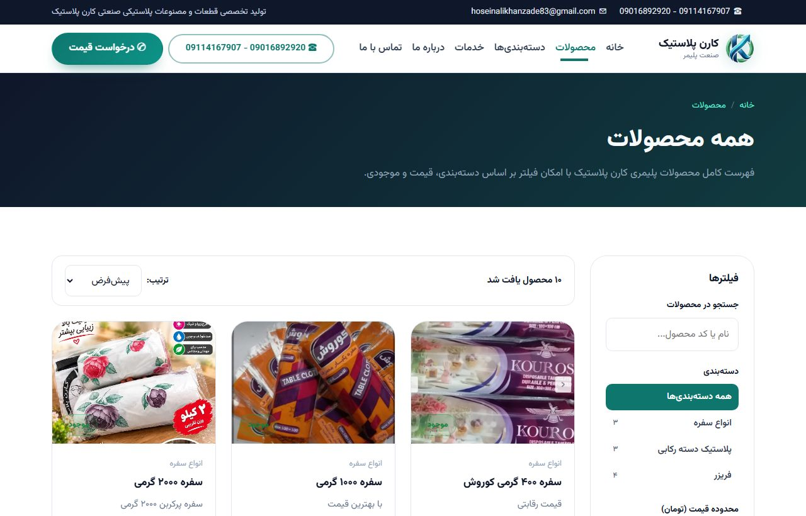
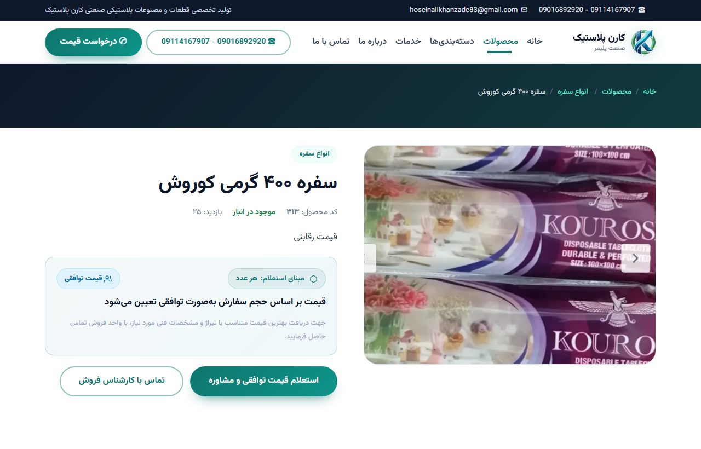
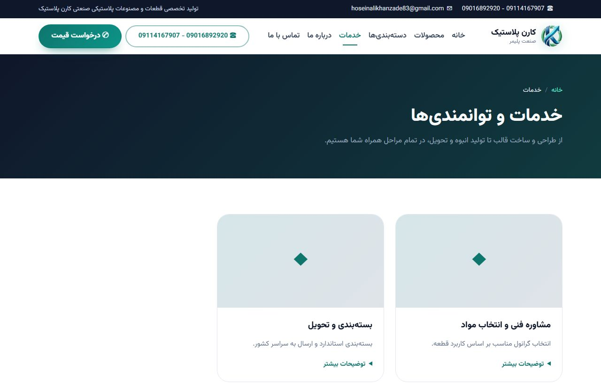
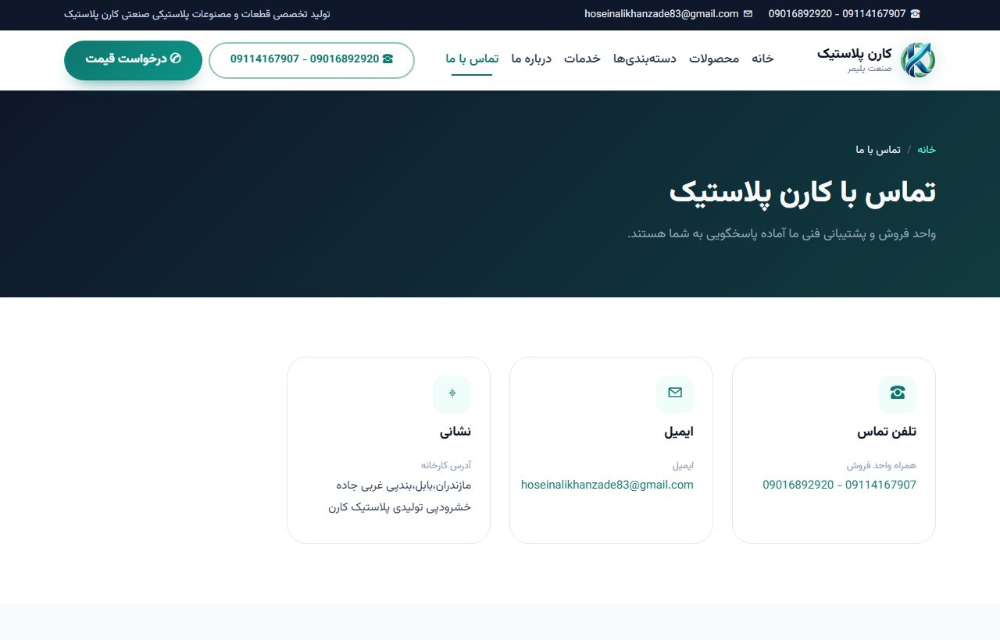
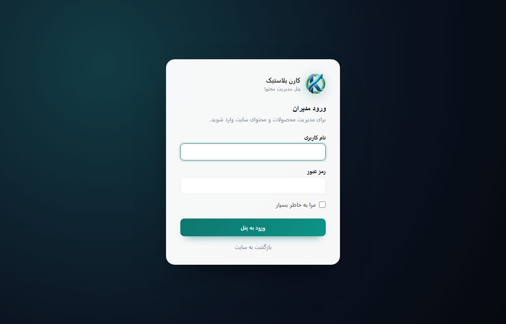

  

  # کارن پلاستیک | Karen Plastic

  **وب‌سایت رسمی و کاتالوگ دیجیتال محصولات پلیمری**

  
  
  

---

  
## درباره کارن پلاستیک

وب‌سایت **کارن پلاستیک** کاتالوگ آنلاین یک مجموعه صنعتی تولیدکننده انواع محصولات پلیمری شامل نایلون، نایلکس، کیسه فریزر و سفره‌های یکبار مصرف بهداشتی است. این پلتفرم امکان مشاهده محصولات، بررسی مشخصات فنی و ارتباط مستقیم با واحد فروش را برای مشتریان فراهم می‌کند.

---

## امکانات سایت

### بخش عمومی (ویترین)

- **صفحه اصلی:** اسلایدر معرفی برند، آمار شرکت، محصولات برگزیده و دسترسی سریع به دسته‌بندی‌ها
- **کاتالوگ محصولات:** نمایش کارتی محصولات با دسته‌بندی، جستجو، وضعیت موجودی و برچسب تخفیف
- **جزییات محصول:** مشخصات فنی (ابعاد، گرماژ، جنس)، گالری تصاویر و دکمه تماس سریع با فروش
- **خدمات:** معرفی خطوط تولید و توانمندی‌های صنعتی
- **تماس با ما:** فرم ارسال پیام آنلاین، شماره‌های تماس و نقشه موقعیت
- **طراحی واکنش‌گرا:** سازگار با موبایل، تبلت و دسکتاپ

### پنل مدیریت

- مدیریت محصولات و دسته‌بندی‌ها
- مدیریت اسلایدرها و بخش‌های محتوایی (درباره ما، مزایا، خدمات و...)
- بهینه‌سازی خودکار تصاویر آپلود‌شده
- صندوق پیام‌های دریافتی از مشتریان
- تنظیمات عمومی سایت و سئو

---

## پیش‌نمایش بخش‌های مختلف سایت

### صفحه اصلی

  

 

### کاتالوگ محصولات

  

 

### جزییات محصول

  

 

### خدمات و توانمندی‌ها

  

 

### تماس با ما

  

 

### پنل مدیریت

  

---

## فناوری‌ها

| فناوری | توضیحات |
|--------|---------|
| .NET 8 / C# | فریم‌ورک اصلی |
| ASP.NET Core MVC | ساختار وب |
| Entity Framework Core | دسترسی به دیتابیس |
| SQL Server | پایگاه داده |
| Bootstrap 5 (RTL) | رابط کاربری |
| ImageSharp | پردازش تصاویر |

---

## لینک‌ها

- 🌐 **وب‌سایت:** [karenplastic.ir](https://karenplastic.ir)

---

  طراحی و توسعه با ❤️ برای گروه صنعتی کارن پلاستیک

